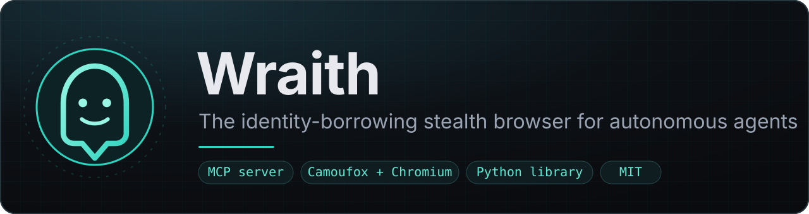
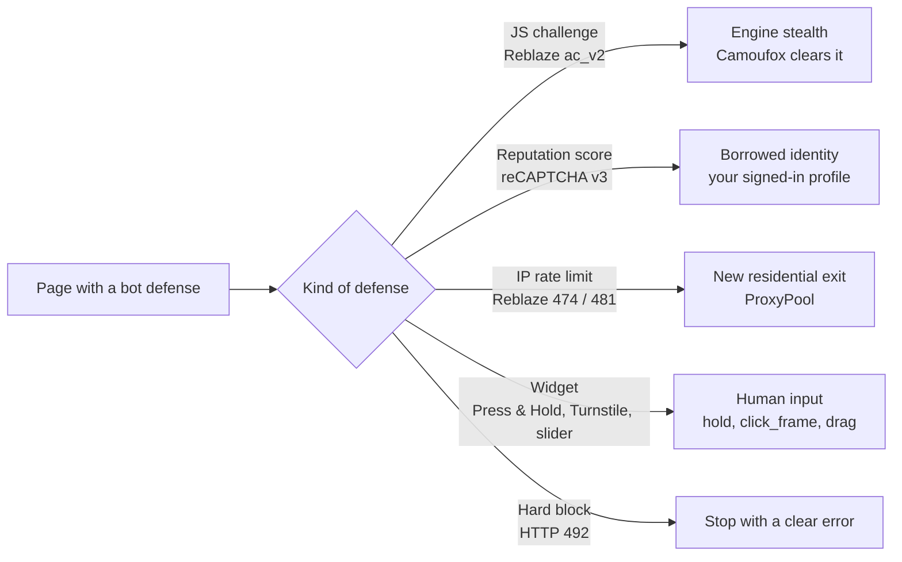
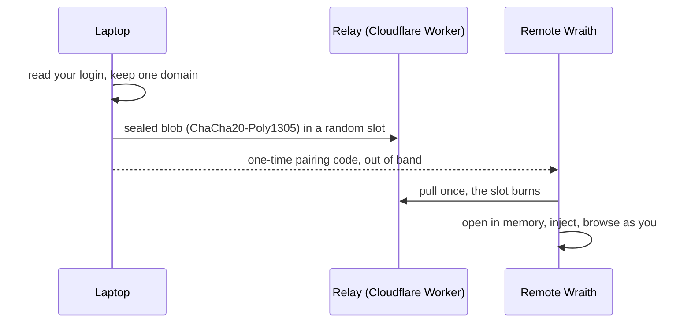
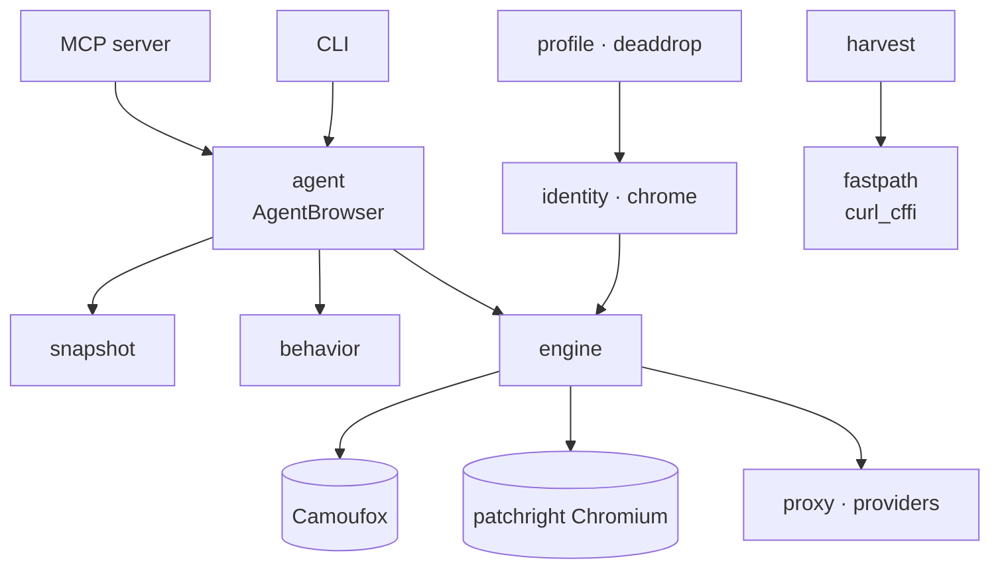

<p align="center">
  
</p>

<p align="center">
  <a href="https://github.com/YogevKr/wraith/actions/workflows/ci.yml"></a>
  <a href="https://github.com/YogevKr/wraith/actions/workflows/stealth-benchmark.yml"></a>
  <a href="LICENSE"></a>
  
  
</p>

<p align="center">
  <b>A real browser for AI agents: hard to fingerprint, simple to drive, and signed in as you.</b>
</p>

<p align="center">
  <a href="#quickstart">Quickstart</a> ·
  <a href="#mcp-tools">MCP tools</a> ·
  <a href="#python-library">Python</a> ·
  <a href="#how-wraith-gets-through">How it works</a> ·
  <a href="docs/AGENTS.md">Agent guide</a> ·
  <a href="https://wraithbrowser.dev">Website</a>
</p>

---

Wraith gives an agent a stealth browser: Camoufox (a hardened Firefox) or a
patched Chromium. The agent reads each page as a numbered list of controls
and acts by number. Wraith runs as a CLI, a Python library, and an MCP
server.

Some sites score reputation, not behavior. A new automated profile always
scores as a bot there. Wraith does not try to fake that history. It
**borrows your own signed-in session** from your real browser profile, so
the site sees you.

> [!IMPORTANT]
> Wraith is a dual-use tool. Use it on your own accounts and data, or with
> permission to test a site. Read [Responsible Use & Legal](#responsible-use--legal)
> before you start.

## What the agent sees

```text
→ navigate("https://news.ycombinator.com/login")
URL: https://news.ycombinator.com/login
[0] @ (82,167)<a role=link href="forgot">Forgot your password?</a>
[1] @ (29,131)<input role=button type="submit" value="login">login</input>
[3] @ (175,60)<input role=textbox type="text" name="acct"/>
[4] @ (175,86)<input role=textbox type="password" name="pw"/>
…
→ type_text(3, "ada")
→ fill_secret(4, capability)    # a broker fills the password; the model never sees it
→ click(1)
```

Each line is one visible control that receives the pointer, with its point
on the page. A modal hides the controls under it. After each action, Wraith
reports what changed and the new text on the page.

## Why Wraith

<table>
<tr>
<td width="50%" valign="top">

**🥷 Stealth engines**<br>
Camoufox first, patched Chromium second. Both pass the rebrowser automation
leak checks on macOS and Linux. The TLS and HTTP/2 fingerprint matches the
browser in the User-Agent.

</td>
<td width="50%" valign="top">

**🪪 Borrowed identity**<br>
Reuse your own signed-in session from Firefox, Zen, or Chrome. Reputation
systems such as reCAPTCHA v3 see your history, not a new profile.

</td>
</tr>
<tr>
<td valign="top">

**🤖 Made for agents**<br>
Numbered snapshots, actions by number, change reports, frames, sliders,
uploads, tabs, and a network log. `read(find=…)` returns only the passages
you need.

</td>
<td valign="top">

**🛡️ Guard rails**<br>
Domain allowlist, page-text markers, opaque secret fills, an upload folder
allowlist, and a watchdog that replaces a stuck browser.

</td>
</tr>
<tr>
<td valign="top">

**⚡ No-browser fast path**<br>
Clear a challenge once in the browser. Then replay the session over HTTP
with the same TLS hello, through curl_cffi.

</td>
<td valign="top">

**🔁 Profile sync**<br>
Move a login for one domain from your laptop to a remote Wraith, through
an end-to-end encrypted dead-drop. No account and no open port.

</td>
</tr>
</table>

## Measured results

The [stealth benchmark](.github/workflows/stealth-benchmark.yml) runs every
week on GitHub runners, headless. Run of 2026-10-17:

| Check | Camoufox<br>macOS | Camoufox<br>Linux | Chromium<br>macOS | Chromium<br>Linux |
| --- | :-: | :-: | :-: | :-: |
| rebrowser leaks: `runtimeEnableLeak`, `navigatorWebdriver`, `pwInitScripts`, `viewport`, `bypassCsp`, `nativeTampering` | ✅ | ✅ | ✅ | ✅ |
| Headless signal | ✅ | ✅ | ✅ | ⚠️ ¹ |
| TLS 1.3, HTTP/2 settings, and header order match the User-Agent | ✅ | ✅ | ✅ | ✅ |
| Fast path replays with the browser's own TLS hello | ✅ | ✅ | ❌ ² | ❌ ² |

¹ The Linux runner has no GPU, so WebGL uses SwiftShader.<br>
² Chrome 155 sends TLS extension 51764. curl_cffi cannot send it.

Interactive challenges on public demo pages, with the agent aiming from a
`screenshot()`:

| Challenge | Tool | Result |
| --- | --- | --- |
| Cloudflare Turnstile (nowsecure.nl) | `click_frame` | 3 of 3 solved |
| GeeTest v3 slide puzzle | `drag` | 2 of 2 passed |
| GeeTest v4 slide puzzle | `drag` | passed |
| Lemin drag-the-piece puzzle | `drag` | passed |

Vendors change their checks. These results are not a promise for your site.

## Quickstart

### 1. Install

From source, with [uv](https://docs.astral.sh/uv/):

```bash
git clone https://github.com/YogevKr/wraith && cd wraith
uv sync
uv run camoufox fetch official/152.0.4-beta.30   # Wraith's pinned Camoufox build
uv run patchright install chromium               # optional: the Chromium engine
```

Or with pip:

```bash
pip install "wraith[fastpath] @ git+https://github.com/YogevKr/wraith"
camoufox fetch official/152.0.4-beta.30
```

> [!NOTE]
> The name `wraith` on PyPI belongs to a different project. Install from
> GitHub as shown.

### 2. Connect your MCP client

```bash
# Claude Code, from a clone
claude mcp add wraith -- uv run --directory /path/to/wraith wraith-mcp

# Claude Code, without a clone
claude mcp add wraith -- uvx --from git+https://github.com/YogevKr/wraith wraith-mcp
```

For Claude Desktop and other clients, see
[docs/AGENTS.md](docs/AGENTS.md#4-the-mcp-server--wraith-mcp).

### 3. Ask

> Open the English Wikipedia article on Tel Aviv and tell me the city's
> population.

With `read(find="population")`, the agent gets the passages that contain the
term in one call, not the whole article.

## Python library

```python
from wraith import agent_browser

with agent_browser(engine="camoufox", headless=True) as ab:
    snap = ab.navigate("https://en.wikipedia.org/wiki/Tel_Aviv")
    print(snap.to_text())           # numbered controls
    print(ab.find("population"))    # passages that contain the term
    ab.click(12)                    # act on control [12]
    ab.type(3, "wraith", enter=True)
    print(ab.read())                # main content as markdown
```

Borrow your own signed-in session:

```python
import wraith

with wraith.browser(engine="camoufox", geoip=True) as s:
    profile = wraith.find_zen_profiles()[0]      # or find_firefox_profiles()
    cookies = wraith.extract_cookies(profile, domain_filter="example.com")
    wraith.inject_cookies(s.context, cookies)
    s.page.goto("https://example.com")           # signed in as you
```

`import wraith` works when an optional browser dependency is missing. It
leaves out the affected symbols and records why in `wraith.missing_imports`.

## MCP tools

| Group | Tools |
| --- | --- |
| Perceive | `navigate`, `snapshot`, `read`, `screenshot`, `wait_for`, `browser_tabs` |
| Act | `click`, `click_at`, `click_frame`, `type_text`, `press_key`, `select_option`, `drag`, `scroll`, `upload_file`, `go_back`, `go_forward` |
| Secrets | `fill_secret`, `fill_vault_item` |
| Network | `network_requests`, `network_response`, `fetch` |
| Identity | `borrow`, `receive_profile`, `save_state`, `ensure_high_score` |
| Diagnose | `detect_waap` |

- **`navigate`** attempts HUMAN/PerimeterX Press & Hold challenges and closes
  cookie banners. It reports an error when verification fails.
- **Snapshots** show the chosen option of a `<select>`, the files of a file
  input, and the value of a range or color input. They list frames, and they
  end with `Challenges: turnstile solved` when a challenge token is present.
- **`read()`** returns the main content as markdown, in slices of 20,000
  characters. `read(find="population")` returns only the passages with the
  term. `read(full=True)` includes the page chrome.
- **Frames.** Elements in visible iframes get indices like the main page and
  end with `(frame N)`. For a frame with no readable elements, such as
  Turnstile, call `click_frame(N, x, y)`. `x` and `y` are fractions of the
  frame's own size, also when the frame is rotated or tilted in 3D.
- **`drag(dx, dy, index=…)`** moves a slider knob along a human path: eased,
  with a small wobble, uneven timing, and a short overshoot on long drags.
- **`network_requests` → `network_response` → `fetch`** finds the JSON API
  that a page calls, then calls it without the browser.
- **`upload_file`** is off until you allow folders (see
  [Configuration](#configuration)).

The full tool reference is in [docs/AGENTS.md](docs/AGENTS.md). Restart the
MCP server after you upgrade Wraith.

## Configuration

| Setting | `wraith mcp` flag | Environment variable | Default |
| --- | --- | --- | --- |
| Domain allowlist | `--allowed-domains` | `WRAITH_ALLOWED_DOMAINS` | all hosts |
| Upload folders | `--upload-dir` (repeat) | `WRAITH_UPLOAD_DIRS` (path-separator list) | uploads off |
| Proxy | `--proxy URL\|dataimpulse\|anyip` | `WRAITH_PROXY` | none |
| Proxy country | `--proxy-country` | `WRAITH_PROXY_COUNTRY` | provider default |
| anyIP network | `--proxy-network` | `WRAITH_PROXY_NETWORK` | mixed pool |
| Page-text markers | — | `WRAITH_CONTENT_BOUNDARIES=0` turns them off | on |
| Browser call timeout | — | `WRAITH_TOOL_TIMEOUT` (seconds) | 180 |

Provider credentials come from `DATAIMPULSE_USERNAME` / `DATAIMPULSE_PASSWORD`,
`ANYIP_USERNAME` / `ANYIP_PASSWORD`, or `--proxy-username-cmd` and
`--proxy-password-cmd`. Solver keys come from `CAPSOLVER_API_KEY` and
`TWOCAPTCHA_API_KEY`. See [docs/PLAYBOOK.md](docs/PLAYBOOK.md) for proxy
setup.

## How Wraith gets through

There is no universal bypass. Wraith uses the lowest-cost method that works
for each kind of defense.



1. **Engine stealth.** Firefox skips the Chrome-only detection checks, so
   most fingerprint tells never run. This alone clears solvable JS
   interstitials such as Reblaze/Link11 `ac_v2`. `clear_challenge()`
   navigates and waits for the clearance cookie. It needs no cookies and no
   proxy.
2. **Identity borrowing.** reCAPTCHA v3 has no client-side solver. It returns
   a score from your Google cookies, browsing history, and IP reputation. A
   new profile scores about 0.1–0.3. Wraith injects your own warmed session
   from disk (`extract_cookies` → `inject_cookies`), or captures a live bearer
   token (`SessionHarvester`).
3. **Residential exit rotation.** Cookies and waiting do not clear an IP
   rate limit. `ProxyPool` and the DataImpulse and anyIP providers feed new
   exits into `launch(proxy=…)` and `clear_challenge(proxy_pool=…)`.
4. **Human input.** `navigate` holds a HUMAN Press & Hold button by itself.
   For Turnstile and sliders, the agent aims from a screenshot. Wraith moves,
   clicks, and drags with human timing.
5. **Not solvable.** Hard blocks, and reCAPTCHA v3 with no warmed identity,
   raise an error with the reason. Wraith does not pretend.

[docs/DETECTION.md](docs/DETECTION.md) lists how to identify each vendor.
[docs/PLAYBOOK.md](docs/PLAYBOOK.md) gives the decision steps.

## Sessions: borrow, sync, hand off



- **Borrow** (`wraith borrow`, MCP `borrow`) reads cookies from your Firefox
  or Zen profile and injects them. Chrome needs the explicit
  `wraith profile sync --from chrome` path, which uses the OS keychain.
- **Profile sync** (`wraith profile sync` → `receive_profile`) moves a
  domain-scoped login to a headless box or a cloud VM. The relay sees only
  ciphertext.
- **Hand off** (`save_state(path, for_chromium=True)`) exports a session for
  [agent-browser](https://github.com/vercel-labs/agent-browser).
- **Fast path** (`wraith fetch`, MCP `fetch`) replays a captured session
  without a browser.

Details and limits: [docs/SESSIONS.md](docs/SESSIONS.md).

## Safety

| Control | What it does |
| --- | --- |
| Domain allowlist | Refuses navigation, new tabs, `fetch`, and `detect_waap` for other hosts before any request. Aborts subrequests and WebSockets to other hosts. Closes a page that a redirect moved off the list. |
| Page-text markers | Wraps page text in `<untrusted-page-content id="…">` with a random id, so the model can tell page text from instructions. |
| Opaque secret fills | The model passes a capability, and your broker fills the field. Screenshots and state export stop after a fill. See [docs/SECRETS.md](docs/SECRETS.md). |
| Upload folders | `upload_file` reads only from folders that you allow. |
| Network log | After a secret fill, the log refuses bodies and removes query strings. |
| Watchdog | A browser call that does not answer in time fails with `BrowserStuck`. The next call starts a new browser. |

```bash
claude mcp add wraith -e WRAITH_ALLOWED_DOMAINS="example.com,*.example.com" \
  -- uv run --directory /path/to/wraith wraith-mcp
```

`example.com` matches only that host. `*.example.com` also matches every
subdomain. List every host that the site needs, such as CDNs and
`challenges.cloudflare.com`. [SECURITY.md](SECURITY.md) gives the limits of
each control.

## CLI

| Command | What it does |
| --- | --- |
| `wraith agent URL` | Open a URL and print the numbered snapshot (`--json` for JSON). |
| `wraith borrow URL` | Inject your own cookies and open the site as you. |
| `wraith harvest URL` | Capture a live `Authorization` + cookie session to a file. |
| `wraith fetch URL` | Replay a session without a browser, with a browser TLS fingerprint. |
| `wraith detect URL` | Identify the WAAP / bot-defense stack of a URL. |
| `wraith score` | Read this identity's reCAPTCHA v3 score. |
| `wraith v3 URL` | Borrow Google reputation, then open a reCAPTCHA v3 page. |
| `wraith selftest` | Run the rebrowser leak suite; exit non-zero on a leak. |
| `wraith benchmark run` / `compare` | Collect leak, TLS, and HTTP/2 checks; compare two runs. |
| `wraith launch URL` | Open a stealth browser and keep it open. |
| `wraith profile sync` / `receive` / `revoke` | Move a login through the encrypted dead-drop. |
| `wraith clawd-run` | Run a versioned, gated Tailnet and browser flow. |
| `wraith mcp` | Run the MCP server over stdio. |

The default engine is `camoufox`. Use `--engine chromium` for patched
Chromium, or `--engine auto` to let Wraith choose.

<details>
<summary>CLI examples</summary>

```bash
uv run wraith agent https://example.com --json
uv run wraith borrow https://example.com --host example.com
uv run wraith harvest https://example.com --target api.example.com --cookie session -o example.session.json
uv run wraith fetch https://api.example.com/me --session example.session.json --show-body
uv run wraith selftest --json
uv run wraith benchmark run --engine chromium --out results/chromium.json
uv run wraith benchmark compare results --previous last-week --summary summary.md
uv run wraith score --engine chromium --json
uv run wraith detect https://example.com --json
uv run wraith launch https://example.com --headless --no-wait
uv run wraith profile sync --relay https://<name>.workers.dev --from chrome --domain elal.com
uv run wraith profile receive <pairing-code> --open https://www.elal.com/
uv run wraith profile revoke <pairing-code>
```

</details>

## Architecture



<details>
<summary>Modules</summary>

| Module | Responsibility |
| --- | --- |
| [`engine`](wraith/engine.py) | Stealth launcher and engine selection. `launch()` / `browser()` return a `Session` (`.page`, `.context`, `.browser`). `clear_challenge()` is the cookie-free WAAP front door. |
| [`identity`](wraith/identity.py) | Find Firefox, Zen, and Chrome profiles; `extract_cookies()`, `inject_cookies()`. Chrome raises `ChromeEncryptionError` unless you opt into `chrome`. |
| [`chrome`](wraith/chrome.py) | Opt-in Chrome cookie decryptor for `profile sync` (macOS Keychain, Linux Secret Service, Windows DPAPI). Refuses app-bound `v20` values. |
| [`deaddrop`](wraith/deaddrop.py) | End-to-end encrypted transport: one ephemeral secret per transfer gives the relay slot and the `ChaCha20-Poly1305` key. Relay: [`deploy/worker.js`](deploy/worker.js). |
| [`profile`](wraith/profile.py) | `gather_cookies` or `capture_login_jar` → domain-scoped jar → `sync_profile` / `receive_profile`. |
| [`harvest`](wraith/harvest.py) | `SessionHarvester` latches the first request with an `Authorization` header and an auth cookie. |
| [`fastpath`](wraith/fastpath.py) | No-browser replay through curl_cffi with the browser's TLS and HTTP/2 fingerprint. |
| [`detect`](wraith/detect.py) | `identify_waap()`, `recaptcha_v3_score()`, `bot_detector()`, `fingerprint()`. |
| [`behavior`](wraith/behavior.py) | `human_move()`, `human_type()`, `human_drag()`, `dwell()`. |
| [`agent`](wraith/agent.py) | `AgentBrowser` / `agent_browser()`: perceive, then act by index. |
| [`snapshot`](wraith/snapshot.py) | `take_snapshot()` builds the numbered `Snapshot` of visible controls. |
| [`secrets`](wraith/secrets.py) | Opaque secret capabilities, provider registration, and policy errors. |
| [`domains`](wraith/domains.py) | `DomainPolicy`: the host allowlist and its routes. |
| [`recaptcha`](wraith/recaptcha.py) | v3 token harvest from a warmed session, plus `CapSolver` and `TwoCaptcha` clients. |
| [`proxy`](wraith/proxy.py) | `ProxyPool` with cooldown, backoff, half-open, and recovery states. |
| [`providers`](wraith/providers.py) | DataImpulse and anyIP residential (and anyIP mobile) exits. |
| [`benchmark`](wraith/benchmark.py) | The stealth benchmark records and their comparison. |
| [`mcp`](wraith/mcp.py) | The `wraith-mcp` stdio server. |
| [`cli`](wraith/cli.py) | The `wraith` command. Imports each part on demand, so `--help` works on a partial install. |

Examples: [`examples/`](examples/) has `borrow_session.py`, `score_check.py`,
and `detect_waap.py`.

</details>

<details>
<summary>Version pins</summary>

Wraith pins **`playwright == 1.55.x`**. Camoufox 0.4.x crashes on
`playwright >= 1.60` (a Firefox `pageError` serialization bug). Wraith finds
a mismatch at launch and gives an error with the fix. patchright has its own
version and is not affected.

Wraith also pins the Camoufox browser build to **`152.0.4-beta.30`**.
Camoufox `156.0.1-beta.32` removed `navigator.appCodeName`, which the pinned
Python launcher still generates. Wraith selects this build even when newer
releases exist. If it is missing, launch fails with the install command; it
does not fetch a new beta.

The Chromium engine uses an installed Google Chrome when it finds one,
because the bundled Chrome for Testing build is a known bot signal. Pass
`channel="chromium"` to `launch()` to use the bundled build.

</details>

## Docs

| Page | Contents |
| --- | --- |
| [docs/AGENTS.md](docs/AGENTS.md) | Snapshot format, acting by index, all MCP tools, client setup. |
| [docs/PLAYBOOK.md](docs/PLAYBOOK.md) | Engine choice, identity consistency, proxies, Press & Hold, the decision flow. |
| [docs/DETECTION.md](docs/DETECTION.md) | WAAP and bot-defense vendors: how to identify each one. |
| [docs/SESSIONS.md](docs/SESSIONS.md) | Borrow, profile sync, agent-browser handoff, the Clawd flow. |
| [docs/SECRETS.md](docs/SECRETS.md) | Opaque secret capabilities and vault fills. |
| [SECURITY.md](SECURITY.md) | Trust limits and how to report a vulnerability. |
| [CHANGELOG.md](CHANGELOG.md) | Changes in each release. |

## Responsible Use & Legal

Wraith is a **dual-use** tool. Like the other projects in its category
([Camoufox](https://camoufox.com/),
[nodriver](https://github.com/ultrafunkamsterdam/nodriver),
[browser-use](https://github.com/browser-use/browser-use),
[undetected-chromedriver](https://github.com/ultrafunkamsterdam/undetected-chromedriver)),
it can be used well or badly. It is published for **legitimate** purposes:

- Access to **your own** accounts and data, on your own machine, with your
  own warmed browser profile.
- **Authorized** security testing and bot-defense research, where you have
  permission to test the target.
- Personal automation, collection of data that you are entitled to, and
  reproducible research into anti-bot and WAAP systems.

Rules:

- **Respect** the Terms of Service of each site and all applicable laws
  (for example, the CFAA and its equivalents).
- **Identity borrowing reads only your own local browser profiles.** Do not
  use it on accounts or sessions that are not yours.
- **Do not** use Wraith for fraud, account takeover, credential stuffing,
  mass abuse, spam, or to get around access controls that you are not
  authorized to bypass.

You are responsible for how you use this software. If your use is not
clearly one of the legitimate cases above, do not do it. Wraith is released
under the [MIT License](LICENSE) **with no warranty**.

## Tests

```bash
uv run pytest -q
```

The offline suite needs no browser binaries and no network.
`WRAITH_LIVE_TEST=1 uv run pytest tests/test_live_*.py` launches real
browsers against pages on 127.0.0.1 only. The macOS CI job runs them on each
push. The weekly stealth benchmark uses public detector pages
(`bot-detector.rebrowser.net`, `tls.peet.ws`).

## Contributing

Read [CONTRIBUTING.md](CONTRIBUTING.md) for setup, the module layout, and
pull-request norms. In short: branch from `main`, run `uv sync --extra dev`,
keep `uv run pytest -q` green, and run `uv run ruff check .` before you open
a PR.

## License

MIT. See [LICENSE](LICENSE).
